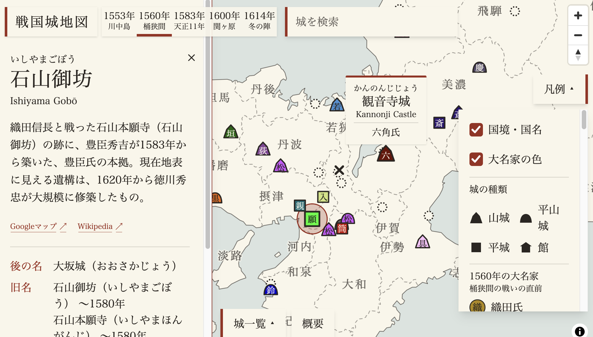

# 戦国城地図 — Sengoku Castle Map

[日本語](README.md) | **English**

An interactive map of 戦国時代 Japan for finding and exploring castles.

**Live site: <https://roymwxuk.github.io/mwx-sengoku-app/>**

[](https://roymwxuk.github.io/mwx-sengoku-app/)

Links can open a castle or a year directly, e.g. [吉田郡山城](https://roymwxuk.github.io/mwx-sengoku-app/?castle=yoshida-koriyama), [大坂城 in 1560 (石山御坊)](https://roymwxuk.github.io/mwx-sengoku-app/?castle=osaka&year=1560) or [Japan in 1614](https://roymwxuk.github.io/mwx-sengoku-app/?year=1614).

## Current status

_As of 2026-11-25._ The map, castles, year switch, detail panel, castle list and search work, with 136 castles and 161 clans. The interface is in Japanese.

| Milestone                        | Status                                        |
| -------------------------------- | --------------------------------------------- |
| M0 Foundations                   | Done, except deferred items                   |
| M1 Map of Japan                  | Done                                          |
| M2 Castles on the map            | Done, except deferred items                   |
| M3 Detail panel, shareable links | Done, except deferred items                   |
| M4 Provinces (令制国) and clans  | Done                                          |
| M5 Years                         | Done: five years, 1553–1614                   |
| M6 Search and filters            | In progress: search, clan filter done         |
| M7 Data growth                   | In progress: 136 castles                      |
| M8 Sengoku look and polish       | In progress: castle list, links, icons done   |
| M9 v1.0 release                  | v1.0.0 released, except better error handling |

Deferred for now: unit and component tests (Vitest), and CI checks. See the [roadmap](docs/ROADMAP.md) for details.

### What works today

- Pan and zoom a map of Japan on desktop and phone
- Hover over a castle for its name; click or tap it for details
- Tell a castle's type (山城, 平山城, 平城 or 館) from the shape of its icon; those not built yet in the year shown are dotted circles, and abandoned ones ✕
- Switch between five years at the top: 1553 (just before 川中島), 1560 (just before 桶狭間), 1582 (just before 本能寺), 1600 (just before 関ヶ原) and 1614 (just before 大坂冬の陣)
- See who held each castle that year, by the clan's colour and kanji; castles whose owner isn't known are grey (城主不明)
- Click a clan in the legend (凡例, top right) to show only the castles it held that year; click it again, or the × below 凡例, to show all
- See province borders and names; these and the clan colours can be turned off (凡例, top right)
- Search for a castle in kanji, kana or romaji (城を検索), by current, former or other name; small typos are fine
- See a castle under its former name in the years it was used (大坂城 is 石山御坊 in 1560)
- Choose a castle from the list (城一覧, bottom left) by mouse, touch or keyboard
- Open a castle's place in Google Maps, and its Wikipedia article or official site if it has one
- See credits, licences and a link to GitHub (概要, bottom left)
- Share a castle, year and clan filter as a link, and step through castles with back and forward

### Known limits

- The coastline is modern and simplified, so it looks angular up close
- No terrain yet, and owners are shown for the five years above only
- Province borders are late-Edo
- With this many clans, some colours look alike; they were chosen to be told apart, not from history
- A retainer's castle may be shown as the ruling clan's, and branch families may be shown together
- Castle data still needs a historical review, and some dates are from general knowledge; see [data sources](docs/data-sources.md)

If you find a mistake, please [open an issue](https://github.com/roymwxuk/mwx-sengoku-app/issues).

## Development

Vite, React, TypeScript, Tailwind CSS, MapLibre GL JS and Zustand. There is no backend; all data is static files. The deploy build uses Node.js 24.

```sh
npm ci
npm run dev
```

| Command                  | What it does                               |
| ------------------------ | ------------------------------------------ |
| `npm run dev`            | Start the dev server                       |
| `npm run build`          | Type-check and build for production        |
| `npm run preview`        | Serve the production build locally         |
| `npm run format`         | Format the code with Prettier              |
| `npm run format:check`   | Check the formatting                       |
| `npm run data:check`     | Validate the castle and clan data          |
| `npm run data:basemap`   | Rebuild the map outline from Natural Earth |
| `npm run data:provinces` | Rebuild the province borders from CODH     |

Every push to `master` is published to GitHub Pages.

### Adding a castle

1. Add it to `public/data/castles.geojson`; the fields are in `src/data/castleSchema.ts`
2. Add any new clan to `public/data/clans.json`, with an unused colour from `scripts/clan-palette.json`
3. Record sources and decisions in [`docs/data-sources.md`](docs/data-sources.md)
4. Run `npm run data:check`

## Licence

- **Code:** [MIT](LICENSE)
- **Data:** each file has its own licence; see [`public/data/LICENSE.md`](public/data/LICENSE.md)

The province borders (`public/data/provinces.geojson`) are CC BY-NC 4.0, so **the app with this data may not be used commercially**: 『旧国・旧郡境界データセット』（CODH作成）「幕末明治地勢地図境界データ」（人間文化研究機構作成）を加工.

Some castles' locations are from [OpenStreetMap](https://www.openstreetmap.org/copyright) (© OpenStreetMap contributors, ODbL).

Made by [roymwxuk](https://github.com/roymwxuk).

## Docs

- [Roadmap](docs/ROADMAP.md)
- [Architecture decisions](docs/adr/README.md)
- [Data sources and licences](docs/data-sources.md)
