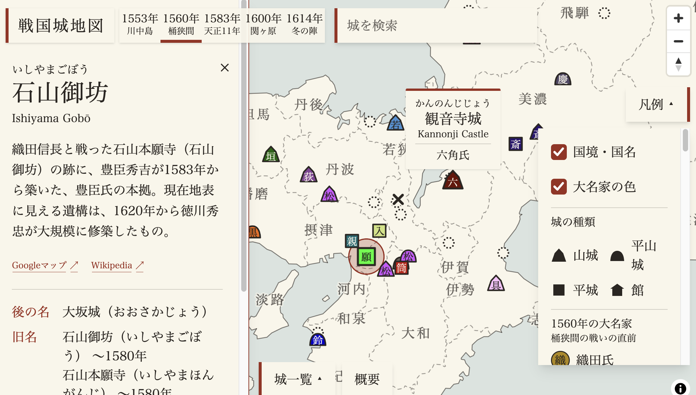

# 戦国城地図 — Sengoku Castle Map

**日本語** | [English](README.en.md)

戦国時代の日本の城を探して調べられる、インタラクティブな地図です。

**公開サイト: <https://roymwxuk.github.io/mwx-sengoku-app/>**

[](https://roymwxuk.github.io/mwx-sengoku-app/)

城を直接開くリンクも使えます（例: [吉田郡山城](https://roymwxuk.github.io/mwx-sengoku-app/?castle=yoshida-koriyama)）。

## 現在の状況

_2026年11月23日現在。_ 地図、城、詳細パネル、城一覧、検索が使えます。収録数は96城です。画面は日本語です。

| マイルストーン                  | 状況                                   |
| ------------------------------- | -------------------------------------- |
| M0 土台                         | 完了（見送り項目を除く）               |
| M1 日本地図                     | 完了                                   |
| M2 地図上の城                   | 完了（見送り項目を除く）               |
| M3 詳細パネル、共有できるリンク | 完了（見送り項目を除く）               |
| M4 令制国と大名家               | 完了                                   |
| M5 年表（1467〜1615年）         | 進行中: 1553〜1600年の年切り替えが完了 |
| M6 検索と絞り込み               | 進行中: 検索が完了                     |
| M7 データの拡充                 | 進行中: 96城                           |
| M8 戦国らしい見た目と仕上げ     | 進行中: 城一覧、リンク、城の記号が完了 |
| M9 v1.0の公開                   | 進行中: 概要が完了                     |

単体・コンポーネントテスト（Vitest）とCIでのチェックは、当面見送っています。詳しくは[ロードマップ](docs/ROADMAP.md)（英語）をご覧ください。

### できること

- パソコンでもスマートフォンでも、日本地図を動かしたり拡大・縮小したりできます
- 城にカーソルを合わせると名前が、クリックまたはタップすると詳細が表示されます
- 城の種類（山城・平山城・平城・館）を、記号の形で見分けられます
- 令制国の境界と国名、1553年（第一次川中島の戦いの直前）、1560年（桶狭間の戦いの直前）、1583年、1600年（関ヶ原の戦いの直前）の城主を表示します。どちらも右上の「凡例」で消せます
- 「城を検索」から、漢字・かな・ローマ字で城を探せます。旧名にも対応し、多少の入力ミスがあっても見つかります
- 選んだ年に旧名で呼ばれていた城は、その名前で表示します（例: 1560年の大坂城は石山御坊）
- 左下の「城一覧」から、マウス・タッチ・キーボードで城を選べます
- 城の場所をGoogleマップで、解説をWikipediaや公式サイトで開けます
- 左下の「概要」に、出典とライセンス、GitHubへのリンクがあります
- 城をリンクで共有でき、ブラウザの「戻る」「進む」で城を行き来できます

### 既知の制限

- 海岸線は現代のものを簡略化しているため、拡大すると角張って見えます
- 地形はまだ表示できません。大名家の色は1553年、1560年、1583年、1600年のみです
- 令制国の境界は江戸時代末期のものです
- 城のデータは、歴史面での確認がまだ必要です。[データの出典](docs/data-sources.md)（英語）をご覧ください

## 開発

Vite、React、TypeScript、Tailwind CSS、MapLibre GL JS、Zustandを使っています。バックエンドはなく、データはすべて静的ファイルです。公開用のビルドにはNode.js 24を使います。

```sh
npm ci
npm run dev
```

| コマンド                 | 内容                                   |
| ------------------------ | -------------------------------------- |
| `npm run dev`            | 開発サーバーを起動する                 |
| `npm run build`          | 型チェックをして、公開用にビルドする   |
| `npm run preview`        | 公開用のビルドを手元で表示する         |
| `npm run format`         | Prettierでコードを整形する             |
| `npm run format:check`   | 整形済みかどうかを確認する             |
| `npm run data:check`     | 城と大名家のデータを検証する           |
| `npm run data:basemap`   | Natural Earthから日本の輪郭を作り直す  |
| `npm run data:provinces` | CODHのデータから令制国の境界を作り直す |

`master`にプッシュするたびに、GitHub Pagesへ公開されます。

## ライセンス

- **コード:** [MIT](LICENSE)
- **データ:** ファイルごとにライセンスが異なります。[`public/data/LICENSE.md`](public/data/LICENSE.md)（英語）をご覧ください

令制国の境界（`public/data/provinces.geojson`）はCC BY-NC 4.0です。そのため、**このデータを含むアプリの商用利用はできません**。出典: 『旧国・旧郡境界データセット』（CODH作成）「幕末明治地勢地図境界データ」（人間文化研究機構作成）を加工

## ドキュメント（英語）

- [ロードマップ](docs/ROADMAP.md)
- [設計上の決定（ADR）](docs/adr/README.md)
- [データの出典とライセンス](docs/data-sources.md)
